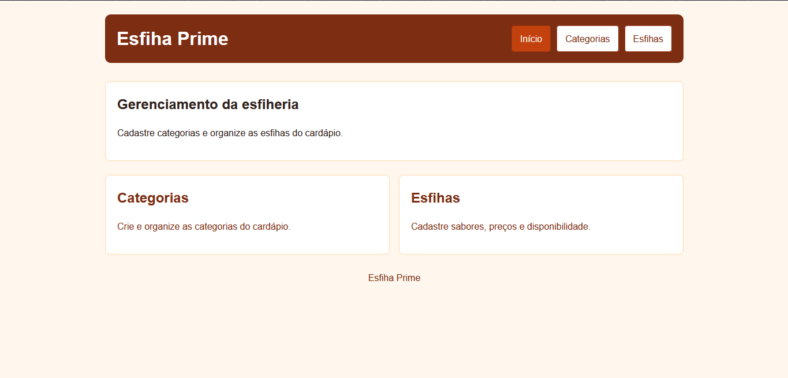
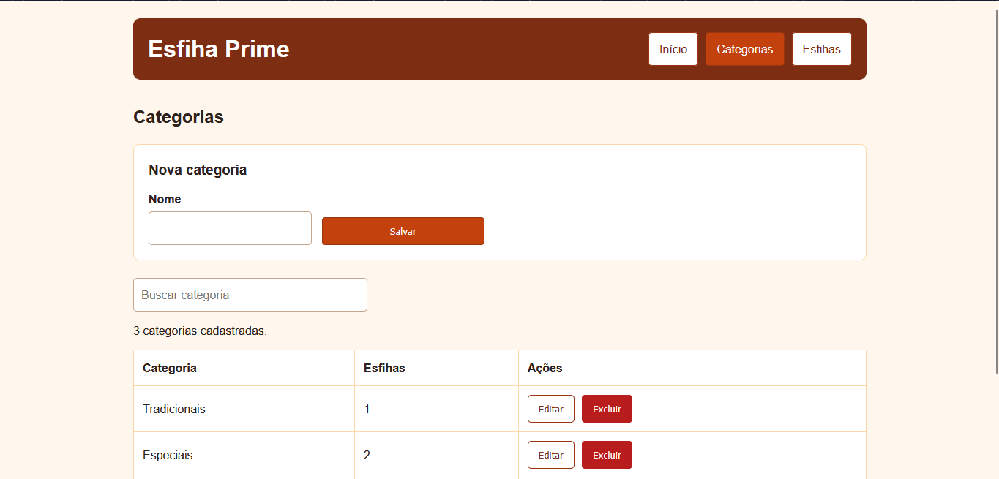
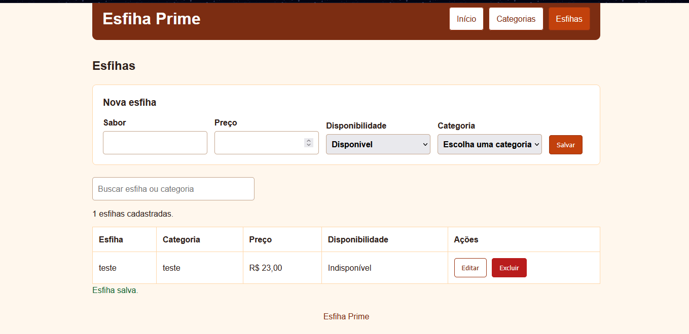

# Esfiha Prime — Frontend

Interface web estática do Esfiha Prime para gerenciar categorias e esfihas do cardápio.

> Este frontend complementa o [backend do Esfiha Prime](../README.md). A interface envia requisições para a API; o backend aplica as regras e salva os dados no PostgreSQL hospedado no Neon.

**API consumida:** [https://neon-db.vercel.app](https://neon-db.vercel.app)

## Tecnologias

- HTML
- CSS
- JavaScript
- Fetch API

## Como funciona

O arquivo `script.js` centraliza as chamadas para a API publicada. Cada ação da interface usa uma rota do backend e atualiza a tabela correspondente após a resposta.

```text
Navegador → Frontend estático → API na Vercel → PostgreSQL no Neon
```

O front-end não acessa o banco Neon diretamente. A `DATABASE_URL` permanece somente no backend, como variável secreta da Vercel.

## Páginas

| Página | Função |
| --- | --- |
| `index.html` | Redireciona para a página inicial quando `web/` é publicada diretamente |
| `home.html` | Exibe os atalhos principais do sistema |
| `categorias.html` | Cadastro, busca, edição e exclusão de categorias |
| `esfihas.html` | Cadastro, busca, edição e exclusão de esfihas |

## Telas

### Início

Página principal com atalhos para o gerenciamento de categorias e esfihas.



### Categorias

Tela para cadastrar, pesquisar, editar e excluir categorias, exibindo a quantidade de esfihas vinculadas a cada uma.



### Esfihas

Tela para cadastrar sabores, definir preço e disponibilidade, escolher uma categoria e gerenciar a listagem.



## Categorias

A página de categorias permite criar categorias para o cardápio, como Tradicionais, Especiais e Doces. A tabela mostra quantas esfihas existem em cada categoria.

Uma categoria com esfihas vinculadas não pode ser excluída até que essas esfihas sejam removidas. Isso evita erro de relacionamento no banco.

## Esfihas

Para cadastrar uma esfiha, informe:

- Sabor;
- Preço;
- Disponibilidade;
- Categoria.

As categorias cadastradas aparecem automaticamente no seletor do formulário. A listagem mostra o preço em real, a categoria e o status de disponibilidade.

## Edição, exclusão e busca

Nas tabelas, o botão **Editar** preenche o formulário com os dados do registro. Depois de salvar, a mesma rota de atualização da API é utilizada. O botão **Cancelar** limpa o formulário e volta ao modo de cadastro.

Os campos de busca filtram as categorias e as esfihas mostradas na tela. A exclusão pede confirmação antes de enviar a requisição ao backend.

## Estrutura

```text
web/
├── index.html           # Entrada para hospedagem da pasta web
├── home.html            # Início
├── categorias.html      # Gestão de categorias
├── esfihas.html         # Gestão de esfihas
├── style.css            # Estilos da interface
└── script.js            # Lógica e integração com a API
```
